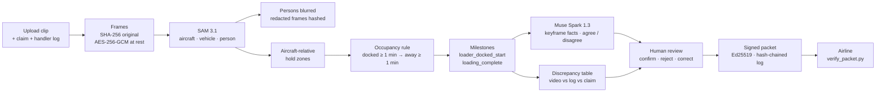
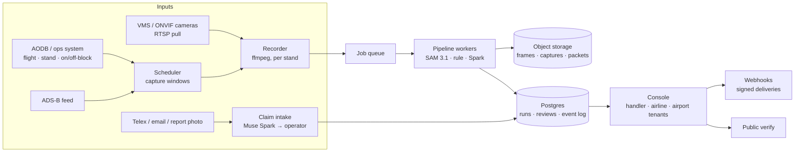

# TurnProof

**Video-backed, delay-code-linked turnaround evidence for airport ground handlers.**

Upload one stand-camera clip, the airline's delay claim and your own milestone log. TurnProof finds
the one event that most delay disputes turn on — *loading equipment docked at the hold → loading
complete* — puts it against the claim and the log, lets a human confirm or reject it, and produces a
signed, hash-verified evidence packet the airline can check with a standalone script. Anyone can
re-verify a packet offline with a standalone script — no Meta API key needed. Running fresh model
inference requires a Meta Model API key. Production access is role-based login for handler and
airline.

Built for the **Meta Global AI Developer Hackathon 2026** (Startup track) on the Meta Model API:
**SAM 3.1** for text-prompted detection of the aircraft and any loading equipment, **Muse Spark 1.3**
for structured keyframe facts that can *flag* a candidate but never *decide* it.

> All flight, claim and log data in this repository and the demo are **synthetic test data on
> licensed footage**. Persons are blurred before anything is displayed. Three clips were used; every
> number here is indicative, not a benchmark.

---

## What you see

| Ground handler | Airline reviewer |
| --- | --- |
| One card per clip. Open it: two big frames — *equipment at the hold* → *hold clear* — with SAM 3.1 boxes, the occupancy timeline under the video, milestone times against the handler log and the claim, Muse Spark's keyframe facts, and **Confirm / Reject / Correct → Send**. | Only packets the handler has **sent**. Claim vs what the video supports, key frames with hashes, **Verify packet now** (runs the verifier live), **Tamper test**, Download JSON / PDF, **Acknowledge / Dispute**. |

Every decision is appended to a hash-chained event log. Models detect and flag; humans decide.

The Handler/Airline switch is a demo toggle with no authentication; `/login` is a disabled
placeholder. Production needs real logins and per-organisation access (see
`BACKEND_REQUIREMENTS.md` §3.1).

## How it works



1. **Ingest.** Every frame is hashed before anything touches it, then encrypted at rest. A redacted copy (persons blurred from SAM's `person` boxes) is what the console shows and what the packet hashes.
2. **Detect.** SAM 3.1 is prompted with three nouns on the whole video: `aircraft`, `vehicle`, `person`. No equipment-specific model, no tracking: belt loader, container loader, dolly train — anything SAM calls a vehicle counts.
3. **Zones.** Hold zones are fractions of SAM's aircraft box, chosen per camera view (`config/config.yaml`), so they move with the aircraft and never need pixel calibration.
4. **Rule.** The share of any vehicle box inside the hold zone is sampled twice a second, smoothed, and run through a hysteresis rule with thresholds in *real* seconds (scaled by the clip's declared speed factor): docked ≥ 1 min, then away ≥ 1 min → `loading_complete`. Short gaps are merged. Equipment already present at the clip start is flagged as an upper bound; a departure cut short by the clip end is flagged too.
5. **Check.** Muse Spark 1.3 gets the keyframes (mid-docked, departure, +3 s, and a zoomed hold crop) and returns strict JSON: observed facts, hold-door state, and whether it agrees that the equipment departed. If it disagrees, the packet names no minutes and no code; the operator decides. Spark's suggested delay-code family is stored as a note and never read by the claim logic.
6. **Compare.** Milestones against the handler log and the airline claim window: *claimed minutes* vs *minutes of the window during which loading was still in progress*. The proposed delay-code family comes from the rule alone.
7. **Sign.** Packet = canonical JSON → SHA-256 → Ed25519. It carries the head of the event-log chain at build time; later human decisions extend the chain, and the verifier accepts the anchor anywhere in an intact chain.

## Event library

One rule engine, several turnaround events. `config/config.yaml` → `events:` names, for each event, the SAM concept that counts as equipment, the zones (per camera view) where it docks, the milestone names it emits, and the IATA delay-code families a claim must belong to for the video to support it.

| Event | Milestones | Delay-code families | Status |
| --- | --- | --- | --- |
| **loading** — loading equipment at the hold | `loader_docked_start` → `loading_complete` | 31–39 | validated on three licensed clips (not distributed): a complete cycle on clip1 and clip3, none on clip2 |
| fuelling — fuel truck at the wing | `fuel_truck_docked_start` → `fuelling_complete` | 36 | defined; zone fractions not yet checked on footage |
| catering — catering truck at the forward door | `catering_docked_start` → `catering_complete` | 37 | defined; zone fractions not yet checked on footage |

Pick the event in the upload form (or `event=` on `POST /api/upload`). An unvalidated event runs the same pipeline and is labelled as unvalidated in the console and in the packet (`models.sam.event`). Adding an event is a config entry plus a zone preset per view — no model change.

## Claim intake

Airlines send MVT / DLA telex lines, emails, or scanned delay reports, not JSON. **Claim intake** (`/intake`) sends the message — text or a photo — to Muse Spark with a strict JSON schema and gets back the delay code, minutes, claim window and flight; a deterministic telex parser runs alongside as a cross-check; the operator confirms before it becomes an input. The message, Spark's raw answer and the confirmed values are stored together with the scenario, and the packet records the claim's source as "via Muse Spark claim intake, confirmed by operator".

## Three demo cases: a claim supported, a claim partly supported, and no verdict

The console starts empty: it lists only claims registered in it (New Claim, or typed on the upload page) and footage uploaded or recorded through it; the `scenarios/` folders in the repo are test fixtures for the CLI and the test-suite. `make reset-demo` moves runs, claims, uploads and deliveries to `data/archive/<timestamp>/` and keeps the model cache, so a demo can be replayed from zero at no model cost.

Every case ends in one of four outcomes, computed by the rule alone and shown on the case, the packet and both work queues, with the money at the contract rate on file:

| Outcome | Meaning |
|---|---|
| **Claim not supported** | the event finished before the claimed window: no penalty minutes attributable to the handler |
| **Claim partly supported** | the event was still in progress for part of the window: those minutes are the handler's, the rest are not |
| **Claim supported** | the whole claimed window overlaps the event: the penalty stands |
| **Cannot be determined** | no completion observed, footage not time-synchronized, or no claim window |

`docs/DEMO_SCRIPT.md` walks through the three demo cases step by step: XY123 (clip1: all 3 claimed minutes supported — claim supported), XY456 (clip3: 2 of 12 minutes supported; the airline disputes; the handler's resolution is recorded in the review record and the hash-chained event log, while the latest signed packet reflects the airline's dispute) and XY789 (clip2: no completed event, no packet; the run summary shows `status: no_candidate` and `minutes_supported_by_video: null`, which the console labels "cannot be determined"). `python scripts/run_demo_cases.py` registers the claims and uploads the footage with the values in `config/demo_cases.json`; the decisions are made by hand in the console. `examples/` holds the signed packets these cases produced.

## Station board

The handler's front page opens with the numbers a station manager runs on, all computed from the runs: turnarounds reviewed, minutes claimed vs minutes the video supports, **penalty exposure the video does not support** at the SLA rate declared per contract (synthetic in the demo), packets sent / acknowledged / disputed, Spark agreement with the rule, model spend per turnaround.

## From one clip to a station: how footage and claims arrive

| Input | v0.1 (this repository) | Pilot |
| --- | --- | --- |
| Footage | **Upload** (form or `POST /api/upload`), or the **Station** page: stand cameras registered by RTSP/ONVIF/HTTP URL, recorded with ffmpeg for a flight's on-block → off-block window | the same recorder, pulling from the VMS (Milestone, Genetec, Axis…) automatically at on-block |
| Flight context | AODB-style feed file (`config/flights_demo.json`, synthetic) + a live ADS-B adapter (OpenSky) for landing times | the airport's AODB or the handler's ops system; ADS-B as a cross-check |
| Claim | **Claim intake**: MVT/DLA telex, email or report photo → Muse Spark → operator confirms | the same, fed from the handler's mailbox / telex gateway |
| Output to the airline | **Webhook** on send / acknowledge / dispute: the signed packet, HMAC-signed body, to the subscribed endpoint (demo: the built-in inbox page) | the airline's claims system; the public `/verify` page for anyone else |

Machine endpoints (`/api/upload`) take an `X-API-Key` when `TURNPROOF_API_KEYS` is set; the demo runs open on localhost and says so in its responses.

## Scale architecture (what changes for a pilot, and what does not)



Already as it will be in a pilot: the pipeline, the packet format and verifier, the event library, the rule thresholds in real seconds, the recorder and scheduler, intake, webhooks. What v0.1 keeps simple on purpose: runs are folders (one folder per run is already the object-storage layout), the event log is SQLite per run, jobs are threads in the console process, roles are a toggle instead of logins. A pilot swaps those four for object storage, Postgres, a queue, and tenant logins — none of them touches a model or the packet.

## Meta models

| Model | Used for | How | Never does |
| --- | --- | --- | --- |
| `sam-3.1` | aircraft box, loading-equipment boxes, person boxes for redaction | Responses API, `input_video` + one noun phrase, boxes parsed from the special-token output, masks ignored | track identity, name equipment types |
| `muse-spark-1.3` | keyframe facts, hold-door state, agree/disagree with the rule; **claim intake** (telex / email / report photo → structured claim) | chat completions, image data URLs, strict `json_schema` output, reasoning effort medium | set a milestone time, decide a claim, choose the delay code |
| `muse-voice-transcribe-1.0` | the operator's spoken statement, transcribed and signed into the packet on Send | `/v1/asr/transcribe` multipart (`request` + `audio` parts); implemented, not exercised in the demo cases (statements were typed) | — |

API responses are cached per clip under `data/cache/` (key = concept + file SHA-256 + request metadata), so re-running a clip costs nothing. First run of a 40 s, 30 fps clip ≈ $0.75 (SAM, 3 video calls) + $0.02 (Spark). Each run writes its own cost estimate to `run_metrics.json` and the console shows it.

## Quickstart

Requires Python ≥ 3.11 and ffmpeg on PATH. The demo clips come from Pexels and are not
redistributed (see `ATTRIBUTIONS.md`); put your copies in `clips/` as `clip1.mp4`, `clip2.mp4` and
`clip3.mp4`.

Reproduce the three demo cases with `scripts/run_demo_cases.py`:

```bash
git clone https://github.com/daarsai/daars_turnproof.git && cd daars_turnproof
make setup                        # venv, deps, demo signing keys, .env from template
#   put MODEL_API_KEY=... (Meta Model API, Standard mode) into .env
make serve                        # console -> http://localhost:8090
.venv/bin/python scripts/run_demo_cases.py   # second terminal: registers the three claims, uploads clips/clip1-3.mp4
```

The script uses the values in `config/demo_cases.json` and stops before any decision: confirm,
send, acknowledge or dispute in the console by hand.

CLI test path: `make demo CLIP=clips/clip1.mp4` runs the pipeline with the synthetic claim and log
in `scenarios/clip1/`. It is the CLI test path and does not reproduce the video.

Other targets:

```bash
make test                         # offline tests (no API key needed)
make lint
make verify PACKET=data/runs/<run>/packets/<id>.json   # all 7 checks
make tamper PACKET=...            # copy the frames, flip one pixel, expect FAIL
make replay RUN=<run_id>          # re-run a clip from the cache, no API spend
make archive RUN=<run_id>         # hide an old run from the console (moved to data/archive/)
make reset-demo                   # start the console empty (everything moved to data/archive/<ts>/, cache kept)
```

Dockerfile and compose file included; not verified for this release.

Per-clip settings live in `config/config.yaml`: declared clip start time, speed factor (time-lapse footage), and the camera view that picks the hold-zone preset. A clip without a declared start time runs as **unsynced**: milestones get frame numbers, never clock times, and the packet says so.

## Quick verification

`examples/` holds the two signed packets from the demo cases (XY123, XY456), their redacted
evidence frames and event logs, the demo public key, and the run summary of XY789 (no packet; it shows
`status: no_candidate` and `minutes_supported_by_video: null`, which the console labels "cannot be
determined"). From the repository root, after `make setup`:

```bash
.venv/bin/python verify_packet.py examples/xy123-supported/TP-20261103-df350fc7.json \
    --frames examples/xy123-supported/frames --log examples/xy123-supported/eventlog.jsonl \
    --pub examples/turnproof-demo-2026.pub
.venv/bin/python verify_packet.py examples/xy456-partly-supported/TP-20261103-a58696d0.json \
    --frames examples/xy456-partly-supported/frames --log examples/xy456-partly-supported/eventlog.jsonl \
    --pub examples/turnproof-demo-2026.pub
```

Each prints seven `PASS` lines and `RESULT: VERIFIED`.

## Verify a packet yourself

```bash
python verify_packet.py TP-20261101-xxxxxxxx.json \
    --frames display/ --log eventlog.jsonl --pub turnproof-demo-2026.pub
```

Checks: schema version · required fields · no machine speculation field · SHA-256 of every redacted evidence frame · event-log hash chain and the packet's anchor in it · packet hash over canonical JSON · Ed25519 signature. Exit code 0 only if all pass. Standard library plus the `cryptography` package; no TurnProof code needed.

## What is in a packet

`packet_id`, flight / stand / parties, the clip's SHA-256, time-sync declaration (start, speed factor and its source), the airline claim, the handler log, milestones with method and confidence, Muse Spark's observed facts (as facts, with frame ids), the discrepancy table, the proposed claim (`delay_code_family`, `minutes_supported_by_video`, `basis`), evidence frames with original and redacted hashes, the models and prompt hashes used, the review and counterparty state, the event-log head, the packet hash and the signature. Schema 0.1 is enforced with pydantic before anything is written.

## Review states

`OBSERVED → CANDIDATE → UNDER_REVIEW → CONFIRMED | REJECTED → SENT → ACKNOWLEDGED | DISPUTED → RESOLVED → ARCHIVED`

Only `system`, `handler_operator` and `airline_reviewer` move states. Reject, correct, dispute and resolve require a note; so does confirm when Spark flagged the candidate for review or its confidence is below 0.70.

## Limits, plainly

- Three clips, all time-lapse, speed factors **estimated** from vehicle motion (±50 %). Real stand cameras are real-time; the thresholds are already expressed in real seconds.
- Equipment already at the hold when a clip starts gives an **upper bound** for `loader_docked_start`, not a time. A clip that ends while the equipment is away flags `departure cut short by clip end`.
- Hold-door state is `unknown` on this footage; the camera angle never shows the door clearly. The milestone exists in the schema and is only written when Spark sees a closed door.
- The hold zone is a configured fraction of the aircraft box per camera view, not learned. A new camera angle needs a preset (five numbers).
- Only the loading event is validated on footage; fuelling and catering are defined in the event library and labelled unvalidated wherever they appear.
- The Station page's stream is a local RTSP loop of licensed time-lapse footage in the demo (speed ×6); a real stand camera runs at ×1. The ADS-B adapter gives landing times, never stands or on-block times.
- No tracking: a second vehicle passing through the zone extends the docked period. Smoothing and gap-merging handle short events; Spark's keyframe check catches the rest, and the operator decides.
- Accuracy is not claimed. The console shows every number the rule used; the packet records every model and prompt by hash.
- A run uploaded with the Muse Spark keyframe check off stays at "Awaiting AI keyframe check" and cannot be reviewed or sent; re-upload with the check on.

## Roadmap

- Validate the fuelling and catering events on footage.
- Equipment attach/detach timing per piece of ground support equipment (GSE).
- Ramp safety evidence (PPE, restricted-zone entry) with human review.

Proposed; not implemented or validated in this prototype.

## Repository

```
turnproof/            pipeline.py (run), ingest/ (frames, redact, crypto), perception/ (SAM client + parser),
                      zones/, events/ (occupancy rule, milestones, event log), reason/ (Spark client, prompts,
                      schemas), evidence/ (canonical JSON, signing, discrepancy, packet, PDF), review/ (console)
verify_packet.py      standalone verifier
examples/             signed demo packets, redacted evidence frames, event logs, public key
scripts/              smoke tests, key generation, tamper demo, speed-factor estimator
scenarios/<clip>/     synthetic clip_meta.json, airline_claim.json, handler_log.csv
config/config.yaml    models, zone presets, rule thresholds, per-clip declarations
tests/                offline tests: hash chain, signing, state machine, zones, rule, parser, packet
                      round-trip with tamper, console, upload, intake, event library
```

Never committed: `.env`, `keys/*.pem`, `clips/*`, `data/`. Originals are encrypted at rest; the console serves redacted frames only.

## Team and licence

DAARS Instruments Pvt. Ltd., Bengaluru — a founder-led build. Code: Apache-2.0. Demo footage:
Pexels License, not redistributed (see `ATTRIBUTIONS.md`).
